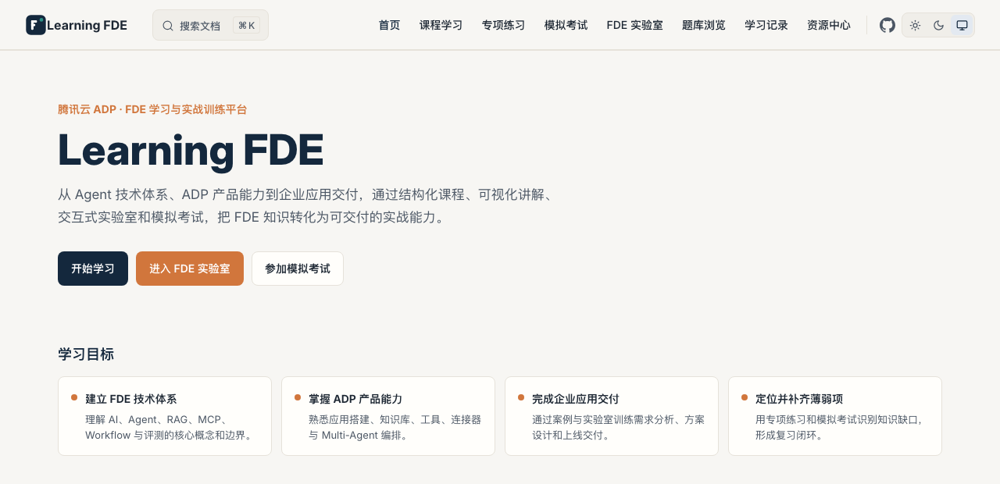
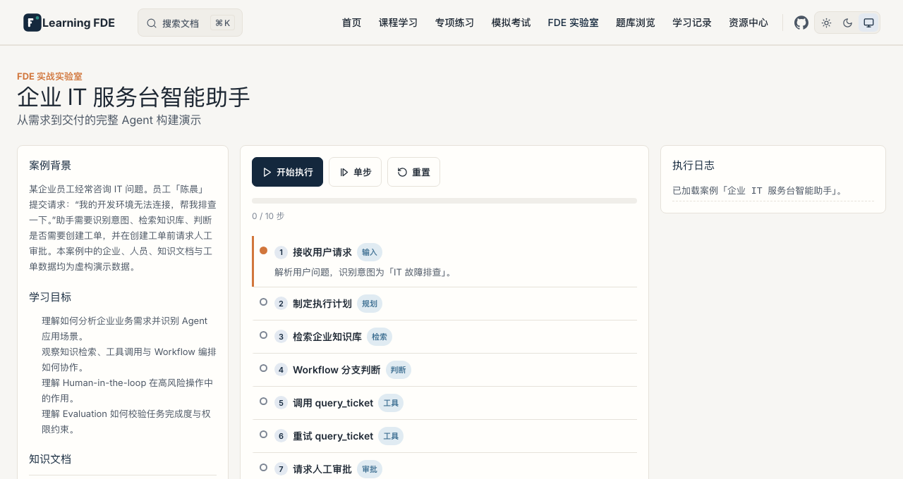

<h1 align="center">
  
  <br />
  Learning FDE
</h1>

<p align="center">
  <a href="https://github.com/zhouminghan/learn-fde/actions/workflows/deploy-pages.yml">
    
  </a>
  
  
  
  
  
  
  
</p>

<p align="center">
  <strong>腾讯云 ADP FDE 学习与实战训练平台。</strong><br />
  通过结构化课程、可视化讲解、交互式实验室和模拟考试，把 FDE 技术体系转化为可交付的企业级 Agent 能力。
</p>

<p align="center">
  在线访问：<a href="https://zhouminghan.github.io/learn-fde/">https://zhouminghan.github.io/learn-fde/</a>
</p>

## 目录

- [为什么有这个项目](#为什么有这个项目)
- [核心能力](#核心能力)
- [页面预览](#页面预览)
- [FDE 实验室](#fde-实验室)
- [学习路径](#学习路径)
- [课程大纲](#课程大纲)
- [快速开始](#快速开始)
- [部署](#部署)
- [内容维护](#内容维护)
- [适合人群](#适合人群)
- [学习要求](#学习要求)
- [核心参考资料](#核心参考资料)
- [技术栈](#技术栈)
- [项目结构](#项目结构)
- [如何组织](#如何组织)
- [许可证](#许可证)
- [免责声明](#免责声明)

## 为什么有这个项目

模型可以回答问题，但能否在真实企业场景里可靠地完成一个 Agent 应用交付，取决于你是否同时掌握三件事：**FDE 技术体系、产品能力边界，以及从需求到上线的交付方法**。

Learning FDE 把这三件事收拢到一个学习闭环里：

```text
    学习闭环
    ========

    课程学习 ──> 可视化讲解 ──> 交互实验
       ▲                          │
       │                          v
    薄弱项复习 <── 成绩报告 <── 模拟考试
```

- **学**：按官方四大模块和补充专题系统学习，每章含目标、机制、案例、误区与自测。
- **看**：架构图、流程图与可交互演示，把抽象概念变成可观察的过程。
- **做**：在 FDE 实验室里逐步执行一个企业 Agent 案例，观察工具调用、异常恢复与人工审批。
- **测**：用专项练习和模拟考试定位薄弱知识域，再回到对应章节复习。

## 核心能力

- **结构化课程**：覆盖官方四大模块与补充专题，包含学习目标、知识讲解、架构图、流程图、业务案例、误区与自测题。
- **FDE 实验室**：以企业 IT 服务台智能助手为案例，逐步模拟 Agent 的意图识别、知识检索、工具调用、Workflow、人工审批与评测。
- **专项练习**：按知识域、章节、题型和难度筛选，答题后即时查看解析。
- **模拟考试**：按官方公开蓝图组卷（60 题 / 单选 40 / 多选 20 / 90 分钟 / 100 分 / 70 分合格），支持倒计时、答题卡、标记、刷新恢复、自动交卷与知识域报告。
- **题库浏览**：搜索、筛选、收藏、查看解析与加入错题本。
- **学习记录**：课程进度、练习与考试记录、错题、收藏，以及本地 JSON 导出/导入。

所有学习数据仅保存在当前浏览器（IndexedDB），不会上传到任何服务器。

## 页面预览





## FDE 实验室

`/lab/` 提供一个完整可运行的企业 IT 服务台智能助手案例：

- 接收用户请求并识别意图。
- 检索企业知识库并展示命中片段。
- 调用模拟 MCP 工具 `query_ticket`、`create_ticket`，展示参数、返回与异常重试。
- 通过 Workflow 分支决定是否创建工单，并在高风险操作前请求人工审批。
- 通过评测规则校验任务完成度、知识依据、工具参数、权限约束与输出格式。
- 生成最终执行报告，区分“批准”与“拒绝”两种结果。

案例企业、人员、知识文档与工单数据均为虚构演示数据；执行过程为本地模拟，不调用真实 LLM、向量数据库或企业系统。

## 学习路径

建议按以下顺序学习，每阶段建立在上一阶段之上：

| 顺序 | 阶段 | 学习重点 |
|---|---|---|
| 1 | AI 与 Agent 基础 | 概念与边界 |
| 2 | ADP 产品能力 | 平台能力与功能 |
| 3 | 使用 ADP 开发智能体 | 方案设计与实战 |
| 4 | 评测与优化智能体 | 调试、评测与调优 |
| 5 | FDE 实验室 + 模拟考试 | 交付与能力评估 |

补充训练专题（场景理解、行业方案、交付运维、安全合规、方案表达）穿插在课程学习之后，用于覆盖考试蓝图与实际交付能力。

## 课程大纲

### 第一部分：AI 和 Agent 基础

| 编号 | 章节 | 链接 |
|---|---|---|
| 1.1 | AI 基础 | [1-1.md](docs/course/01-ai-agent-basics/1-1.md) |
| 1.2 | 大语言模型的进化之路：从“会接龙”到“会做事” | [1-2.md](docs/course/01-ai-agent-basics/1-2.md) |
| 1.3 | 智能体（Agent）基础 | [1-3.md](docs/course/01-ai-agent-basics/1-3.md) |

### 第二部分：ADP 产品能力

| 编号 | 章节 | 链接 |
|---|---|---|
| 2.1 | ADP 是什么：企业级智能体开发平台 | [2-1.md](docs/course/02-adp-capabilities/2-1.md) |
| 2.2-A | 基础能力：应用、模型、角色指令、变量与长期记忆 | [2-2-a.md](docs/course/02-adp-capabilities/2-2-a.md) |
| 2.2-B | 知识与连接能力：知识库、工具、连接器与 Skills | [2-2-b.md](docs/course/02-adp-capabilities/2-2-b.md) |
| 2.2-C | 任务执行与编排能力：Workflow、Multi-Agent 与 Claw | [2-2-c.md](docs/course/02-adp-capabilities/2-2-c.md) |
| 2.3 | 从开发到上线：ADP 应用的完整使用流程 | [2-3.md](docs/course/02-adp-capabilities/2-3.md) |

### 第三部分：使用 ADP 开发智能体

| 编号 | 章节 | 链接 |
|---|---|---|
| 3.1 | 方案设计方法 | [3-1.md](docs/course/03-agent-development/3-1.md) |
| 3.2 | 标准模式实战：知识助手 | [3-2.md](docs/course/03-agent-development/3-2.md) |
| 3.3 | 单工作流模式实战：客服助手 | [3-3.md](docs/course/03-agent-development/3-3.md) |
| 3.4 | Multi-Agent 模式实战：内容创作助手 | [3-4.md](docs/course/03-agent-development/3-4.md) |
| 3.5 | Claw 模式实战 | [3-5.md](docs/course/03-agent-development/3-5.md) |
| 3.6 | 智能工作台实战 | [3-6.md](docs/course/03-agent-development/3-6.md) |

### 第四部分：评测与优化智能体

| 编号 | 章节 | 链接 |
|---|---|---|
| 4.1 | 智能体调试与评测基础 | [4-1.md](docs/course/04-evaluation-optimization/4-1.md) |
| 4.2 | Prompt 调优 | [4-2.md](docs/course/04-evaluation-optimization/4-2.md) |
| 4.3 | 知识库质量与 RAG 调优 | [4-3.md](docs/course/04-evaluation-optimization/4-3.md) |
| 4.4 | Workflow 调优 | [4-4.md](docs/course/04-evaluation-optimization/4-4.md) |
| 4.5 | Multi-Agent 调优 | [4-5.md](docs/course/04-evaluation-optimization/4-5.md) |

### 补充训练专题

| 编号 | 章节 | 链接 |
|---|---|---|
| S1 | 客户场景理解与需求分析 | [s1.md](docs/course/supplementary/s1.md) |
| S2 | 行业解决方案与案例落地 | [s2.md](docs/course/supplementary/s2.md) |
| S3 | 项目交付与运维 | [s3.md](docs/course/supplementary/s3.md) |
| S4 | 安全合规与责任 AI | [s4.md](docs/course/supplementary/s4.md) |
| S5 | FDE 项目沟通与方案表达 | [s5.md](docs/course/supplementary/s5.md) |

## 快速开始

```bash
npm install
npm run dev          # http://localhost:5173/learn-fde/
```

常用命令：

```bash
npm run typecheck        # vue-tsc --noEmit
npm run test             # vitest run（单元测试）
npm run test:e2e         # playwright test（端到端测试）
npm run content:validate # 题目与考试蓝图结构校验
npm run docs:build       # 生产构建
npm run docs:preview     # 预览生产构建
```

## 部署

推送 `main` 分支或手动触发工作流，GitHub Actions 会自动完成安装、类型检查、单元测试、内容校验、构建，并部署到 GitHub Pages。

前置条件：仓库 Pages 的 `Build and deployment > Source` 选择 `GitHub Actions`。

工作流 `.github/workflows/deploy-pages.yml` 执行：

1. `npm ci`
2. `npm run typecheck`
3. `npm run test`
4. `npm run content:validate`
5. `npm run docs:build`
6. 上传 `docs/.vitepress/dist` 并部署

VitePress `base` 由环境变量控制：

```ts
const base = process.env.DOCS_BASE_PATH ?? '/learn-fde/'
```

若仓库名改变，需同步修改工作流中的 `DOCS_BASE_PATH` 与默认值。本地验证部署产物可运行：

```bash
npm run docs:build
npm run docs:preview -- --port 4173
```

## 内容维护

内容目录：

- 课程元数据：`src/content/curriculum.json`
- 考试蓝图：`src/content/exam-blueprint.json`
- 题库：`src/content/questions/*.json`
- 实验室案例：`src/content/labs/*.ts`
- 课程正文：`docs/course/**/*.md`

新增章节：

1. 在 `docs/course/` 对应模块目录新建 Markdown，按统一模板编写。
2. 在 `curriculum.json` 的 `lessons` 中登记稳定 `id`、标题、模块、路径、知识域、来源与核验日期。
3. 补充专题必须设置 `sourceType: "supplementary"`。

新增题目：

1. 在对应知识域 JSON 文件追加题目对象。
2. 校验规则：单选恰好 1 个正确答案；多选至少 2 个；`answerIds` 必须在 `options` 中；正式模拟考只抽取 `status: "published"`。
3. 原创题设置 `sourceType: "original"` 并写清 `authorNote`，不得冒充官方真题。

```bash
npm run content:validate
```

官方信息核验：

- 每次发布前及内容更新后，重新检查腾讯云 FDE 官方考试指南与认证详情页。
- 官方参数变化时，更新 `exam-blueprint.json` 的 `version` 并记录变更依据。
- 多选题判分以官方指南“错选、漏选不得分”为准，实现为完全匹配计分。

## 适合人群

- 备考腾讯云 ADP FDE 认证的学习者。
- 希望系统理解 Agent、RAG、MCP、Workflow 与评测的技术人员。
- 需要把 LLM 应用从概念落地为可交付方案的交付工程师。

本项目不提供真实考试题，也不承诺认证结果。

## 学习要求

- 熟悉终端、Git 与基础前端开发环境。
- 了解大语言模型与智能体的基本概念。
- 愿意通过案例和实验做动手练习，而不只是浏览文字。

## 核心参考资料

- [腾讯云 ADP FDE 官方考试指南](https://cloud.tencent.com/document/product/658/137832)
- [腾讯云 ADP 产品文档](https://cloud.tencent.com/document/product/1759)
- [腾讯云 ADP FDE 认证详情](https://cloud.tencent.com/edu/training/cert/detail?type=CFD)
- [FDE 认证指南与生态伙伴](https://adp.tencent.com/zh/blog/adp-fde-certification-guide)

## 额外练习资源

除本站原创练习外，互联网上还有第三方 FDE 模拟题站点（自称非官方题库，题量较大）可供参考：

- [fde.symio.net](https://fde.symio.net/#course)：第三方 FDE 学习与模拟考试参考站点，约 1200+ 道题目。

该站点为第三方资源，与腾讯云官方无关，其题目并非官方真题，答案与解析准确性未逐题核验；本站未导入、也未转述其题目内容，仅作为学习者的额外参考入口。

## 技术栈

| 分类 | 技术 |
|---|---|
| 站点与框架 | VitePress · Vue 3 · TypeScript |
| 内容与数据 | Markdown/JSON · IndexedDB（Dexie） |
| 可视化 | Mermaid |
| 测试 | Vitest · Playwright |
| 部署 | GitHub Actions · GitHub Pages |

## 项目结构

```text
docs/                  # VitePress 页面、课程正文与主题组件
docs/public/           # 站点图标与 README 预览图
src/content/           # 课程元数据、题库、考试蓝图与实验室案例
src/domain/            # 组卷、判分、评测、统计、实验执行等纯业务逻辑
src/storage/           # IndexedDB 数据访问、迁移与备份
tests/unit/            # 单元测试
tests/e2e/             # Playwright 端到端测试
scripts/               # 内容校验脚本
```

## 如何组织

- 课程正文与 UI 组件解耦：`docs/course/` 管理内容，`docs/.vitepress/theme/components/` 管理交互。
- 案例数据与执行逻辑解耦：`src/content/labs/` 定义案例，`src/domain/lab/` 实现纯函数模拟引擎。
- 内容以 Git 为事实来源，发布前通过 `content:validate` 校验题目结构与考试蓝图。
- 用户学习数据只存本地，历史考试快照与题库更新互不影响。

## 许可证

- 项目源代码采用 [MIT License](./LICENSE)。
- 原创课程正文、原创题目、原创解析与原创教学资料采用 [CC BY 4.0](./LICENSE-CONTENT.md)。
- 腾讯云官方文档、第三方图片/图标/字体/素材、商标及其他外部授权内容不自动纳入本项目许可证，遵循各自原始授权。

## 免责声明

- 模拟考试题目为根据公开知识点设计的原创练习，非腾讯云官方真题。
- 模拟成绩不代表腾讯云官方成绩或认证结果。
- 多选题按官方指南“错选、漏选不得分”判分，项目实现为完全匹配计分。
- 学习数据仅保存在用户浏览器本地。
