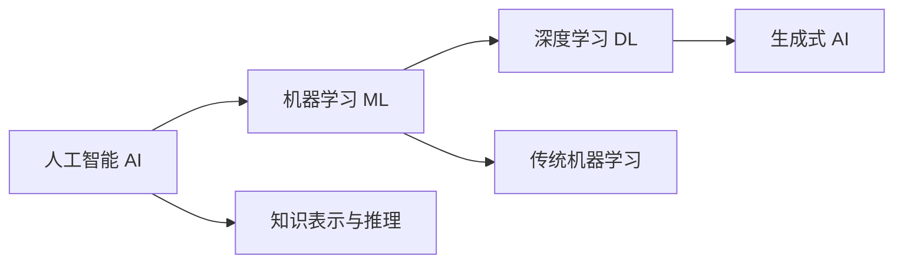

# AI 基础

## 本章目标

学完本章后，你应当能够：

- 解释人工智能、机器学习、深度学习和生成式 AI 之间的关系与边界。
- 区分监督学习、无监督学习与强化学习的基本思路。
- 说明生成式 AI 的典型能力与主要局限。

## 核心概念

- **人工智能（AI）**：让机器表现出理解、推理、决策等智能行为的总体领域。
- **机器学习（ML）**：通过数据让模型自动学习规律，而不是人工编写全部规则。
- **深度学习（DL）**：使用多层神经网络进行表征学习的机器学习方法。
- **生成式 AI**：能够生成文本、图像、代码等内容的人工智能技术。

## 原理与机制

三者是包含关系：人工智能是最大的领域，机器学习是其中的一类方法，深度学习又是机器学习中的一类方法。传统的规则系统需要人工维护大量条件，而机器学习从数据中自动归纳模式。

监督学习使用“输入—标签”成对数据训练模型做分类或回归；无监督学习在没有标签的数据中发现结构；强化学习通过“动作—奖励”的交互学习策略。

## ADP 对应能力

在 ADP 等智能体开发平台中，这些基础概念决定了一个应用适合采用什么形态：规则明确的流程适合工作流，开放式语言理解适合大模型，需要长期策略优化的任务适合带反馈循环的智能体。

## 企业场景

一家客服中心希望从“全人工回复”升级到“机器辅助”。如果只识别固定的退换货规则，可以用规则或简单分类；如果需要理解自然语言、处理多样化诉求，就需要大模型能力。理解 AI 的能力边界，才能选对方案而不是盲目堆模型。

## 风险与常见误区

- **误区**：AI 能解决一切问题。实际上 AI 适合有数据、可验证、容错可控的问题。
- **误区**：模型越大越好。模型能力要与场景、成本、延迟匹配。
- **风险**：把不确定的模型输出直接用于高风险决策。

## 验收标准

能够准确说明 AI / ML / DL 的包含关系，并根据业务问题初步判断是否需要机器学习或大模型能力。

## 本章小结

人工智能是总领域，机器学习是数据驱动的方法，深度学习是其中重要分支，生成式 AI 是当前最受关注的落地方向。理解边界是方案设计的前提。

## 自测题

1. 机器学习与人工智能是什么关系？  
   **答**：机器学习是实现人工智能的一类方法，二者是包含关系。
2. 监督学习与无监督学习的核心区别是什么？  
   **答**：监督学习使用带标签数据，无监督学习在没有标签的数据中发现结构。
3. 为什么不能把所有问题都交给大模型？  
   **答**：大模型有不确定性、成本与延迟，且并非所有问题都有数据或可验证性支撑。

## 来源

- [腾讯云 ADP FDE 认证详情](https://cloud.tencent.com/edu/training/cert/detail?type=CFD)  
  核验日期：2026-11-10
