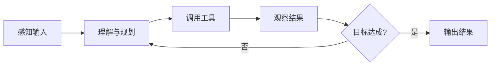

# 智能体（Agent）基础

## 本章目标

学完本章后，你应当能够：

- 定义智能体并列举其核心组成。
- 说明感知、规划、执行与反馈的基本循环。
- 识别典型 Agent 模式与适用场景。

## 核心概念

- **智能体（Agent）**：能够感知环境、做出规划并调用工具执行任务、根据反馈调整的系统。
- **规划**：把目标拆解为可执行步骤的能力。
- **工具执行**：调用外部函数或系统完成具体操作。
- **记忆**：保存短期上下文与长期信息的能力。

## 原理与机制

智能体的典型工作循环是：感知输入 → 理解与规划 → 调用工具执行 → 观察结果 → 根据反馈决定下一步，直到目标完成或触发终止条件。

简单 Agent 只做一轮问答；带工具调用的 Agent 能查询与操作外部系统；自主循环 Agent（如 Claw 模式）会持续规划与调用工具直到完成目标。

<AgentArchitectureDemo />

## ADP 对应能力

ADP 通过角色指令、知识库、工具、连接器、Workflow 与 Multi-Agent 等能力，帮助把上述循环落地为可交付应用。

## 企业场景

一个售后助手需要完成“查询订单状态 → 判断是否符合退换条件 → 生成处理建议”。它可以先调用订单接口，再依据政策规则判断，最后给出结构化答复。每个环节都需要可观测、可兜底。

<AgentExecutionDemo />

## 风险与常见误区

- **误区**：Agent 一定要无限循环执行。缺少终止条件会带来失控与成本。
- **误区**：记忆越多越好。需要区分会话内状态与跨会话记忆。
- **风险**：工具权限过大导致越权操作。

## 验收标准

能够画出 Agent 的感知—规划—执行—反馈循环，并说明记忆、工具与终止条件的作用。

## 本章小结

智能体是大模型与工具、记忆、反馈结合后的执行系统。清晰的循环、边界与终止条件，是可靠交付的前提。

## 自测题

1. 智能体的核心组成通常包括哪些？  
   **答**：感知、规划、记忆、工具执行与反馈。
2. 为什么需要终止条件？  
   **答**：避免无限循环带来成本与不可控。
3. 会话内状态与长期记忆的区别是什么？  
   **答**：前者随会话结束而失效，后者跨会话保留。

## 来源

- [腾讯云 ADP FDE 认证详情](https://cloud.tencent.com/edu/training/cert/detail?type=CFD)  
  核验日期：2026-11-10
