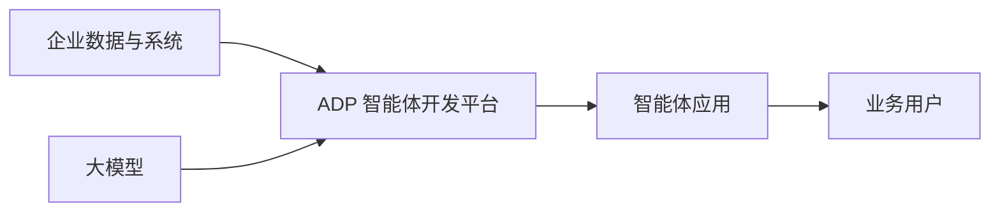

# ADP 是什么：企业级智能体开发平台

## 本章目标

学完本章后，你应当能够：

- 说明 ADP 的产品定位与适用场景。
- 解释其能力边界与企业交付价值。
- 判断一个业务问题是否适合用 ADP 类平台解决。

## 核心概念

- **企业级智能体开发平台**：面向企业应用交付，提供模型、知识、工具与流程编排能力的平台。
- **能力边界**：平台解决模型能力落地与编排问题，业务系统与数据仍由企业掌握。

## 原理与机制

ADP 把大模型能力与企业数据、工具和流程连接起来，形成可交付、可评测、可运维的智能体应用。它处于“模型能力”与“业务系统”之间，负责编排与治理。

## 适用场景

适合知识问答、智能客服、内容创作、业务流程自动化等需要语言理解与编排的场景。不适合替代强一致性的核心交易系统，也不适合实时性要求极高的底层控制。

## 企业场景

某企业需要让员工快速查询内部制度。通过 ADP 接入知识库与搜索工具，搭建内部知识助手，既能降低重复答疑成本，又能保证答案有据可依。

## 风险与常见误区

- **误区**：平台能自动接管全部业务流程。实际仍需要集成、评测与运维。
- **误区**：平台能完全消除大模型不确定性。仍需兜底与验证。
- **风险**：没有明确能力边界就承诺无法实现的效果。

## 验收标准

能够用一句话说清 ADP 的定位，并举例说明适合与不适合的场景。

## 本章小结

ADP 是连接模型能力与企业业务的开发平台，核心价值在于降低落地门槛、统一编排并支撑评测与运维。

## 自测题

1. ADP 的产品定位是什么？  
   **答**：面向企业应用交付的企业级智能体开发平台。
2. 哪些场景不适合用智能体平台替代？  
   **答**：强一致性的核心交易系统、实时性要求极高的底层控制等。
3. 为什么平台不能完全消除不确定性？  
   **答**：大模型本身具有概率性与幻觉风险，需要评测与兜底。

## 来源

- [腾讯云 ADP 产品文档](https://cloud.tencent.com/document/product/1759)  
  核验日期：2026-11-10
