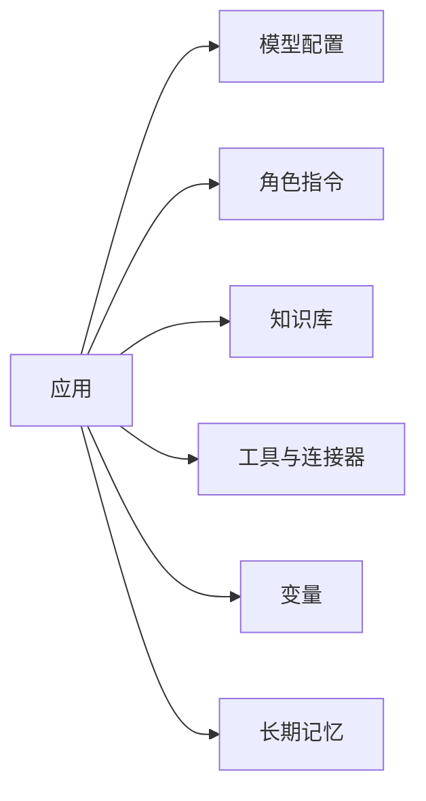

# 基础能力：应用、模型、角色指令、变量与长期记忆

## 本章目标

学完本章后，你应当能够：

- 描述创建一个智能体应用所需的基础配置。
- 区分角色指令、变量与长期记忆的作用。
- 说明模型配置对应用行为的影响。

## 核心概念

- **应用**：承载智能体能力的容器，包含模型、指令、知识与工具配置。
- **模型配置**：选择基础模型并设置温度、输出长度等参数。
- **角色指令**：设定角色身份、行为规范、回答范围与输出格式。
- **变量**：会话内的临时状态，用于在流程节点间传递数据。
- **长期记忆**：跨会话保留的关键用户信息。

## 原理与机制

创建一个应用通常先明确目标与角色，再配置模型、编写角色指令、接入知识与工具。变量承载会话内状态，长期记忆保存跨会话信息，二者作用周期不同。

## 企业场景

一个员工助手需要记住用户的部门信息用于权限判断。部门信息适合放入长期记忆；而当前对话中的临时选择则用变量传递，避免把短期状态误存为长期事实。

## 风险与常见误区

- **误区**：角色指令越长越好。冗长指令反而会稀释关键约束。
- **误区**：把会话内变量当作长期记忆使用。
- **风险**：长期记忆保存敏感信息未做权限控制。

## 验收标准

能够区分并正确使用角色指令、变量与长期记忆。

## 本章小结

应用的基础配置决定智能体的行为边界。角色指令管行为，变量管会话内状态，长期记忆管跨会话信息。

## 自测题

1. 角色指令的作用是什么？  
   **答**：设定角色、行为规范、回答范围与输出格式。
2. 变量与长期记忆的区别是什么？  
   **答**：变量用于会话内临时状态，长期记忆跨会话保留信息。
3. 为什么角色指令不宜一味加长？  
   **答**：会稀释关键约束，增加噪声。

## 来源

- [腾讯云 ADP 产品文档](https://cloud.tencent.com/document/product/1759)  
  核验日期：2026-11-10
