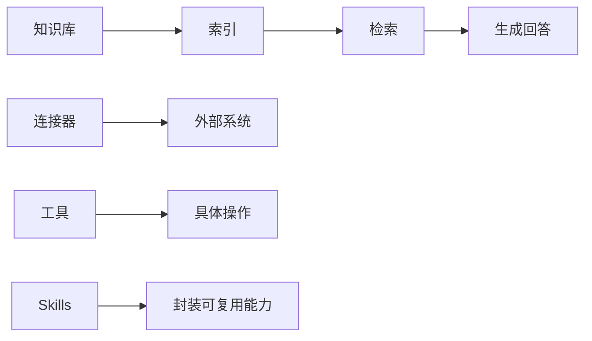

# 知识与连接能力：知识库、工具、连接器与 Skills

## 本章目标

学完本章后，你应当能够：

- 说明知识库在智能体中的作用。
- 区分工具与连接器。
- 解释 Skills 的用途及其与知识库、工具的协作关系。

## 核心概念

- **知识库**：经过清洗与索引、可供检索的企业知识资料集合。
- **工具**：智能体可调用执行的具体能力。
- **连接器**：用于接入外部系统或数据源的连接能力。
- **Skills**：封装提示词、工具组合与流程的可复用能力单元。

## 原理与机制

知识问答通常经历“解析切分 → 建立索引 → 检索相关内容 → 生成回答”的过程。连接器负责连通外部系统，工具负责执行具体操作，Skills 则把多步能力封装为可复用单元，提升一致性与效率。

## 企业场景

一个售后知识助手需要同时查询知识库、调用订单接口并遵循统一的售后话术。知识库负责“知道”，连接器与工具负责“做到”，Skills 负责把“查询+话术”沉淀为可复用能力。

## 风险与常见误区

- **误区**：知识库越大越好。低质量、重复与过时内容会降低检索效果。
- **误区**：Skills 与知识库是同一回事。二者定位不同。
- **风险**：连接器权限过大导致数据越权访问。

## 验收标准

能够说明知识库、工具、连接器与 Skills 的职责分工，并给出一个协作示例。

## 本章小结

知识与连接能力让智能体从“会说话”走向“会做事”。知识库提供依据，连接器与工具提供执行，Skills 沉淀复用。

## 自测题

1. 知识问答通常包含哪些环节？  
   **答**：解析切分、建立索引、检索相关内容、生成回答。
2. 工具与连接器的区别是什么？  
   **答**：连接器接入外部系统，工具执行具体操作。
3. Skills 的价值是什么？  
   **答**：把可复用能力封装成单元，提升一致性与效率。

## 来源

- 腾讯云 ADP 产品文档：https://cloud.tencent.com/document/product/1759  
  核验日期：2026-11-10
