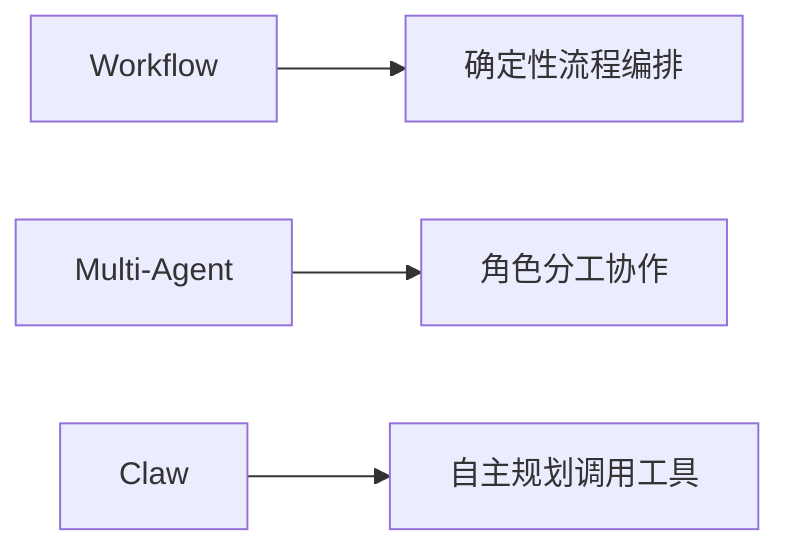

# 任务执行与编排能力：Workflow、Multi-Agent 与 Claw

## 本章目标

学完本章后，你应当能够：

- 说明 Workflow 的节点与流程控制。
- 解释 Multi-Agent 的协作方式。
- 说明 Claw 模式的特点与使用边界。

## 核心概念

- **Workflow**：把任务拆解为节点，通过条件、循环等方式编排执行。
- **Multi-Agent**：将任务按角色拆分给多个智能体协作完成。
- **Claw**：由模型自主规划并循环调用工具完成任务的模式。

## 原理与机制

Workflow 适合步骤确定、分支清晰的流程；Multi-Agent 适合需要角色分工的复杂任务；Claw 模式适合目标明确、步骤可验证且需要多次工具调用的任务。

三者不是互斥的：可以在 Workflow 的某个节点调用 Agent，也可以让 Multi-Agent 内部使用 Workflow。

## 企业场景

客服场景中，工单流转适合 Workflow；内容创作中策划、撰写、审校的分工适合 Multi-Agent；而“根据给定资料自动整理成报告”这类目标明确的任务适合 Claw 模式。

## 风险与常见误区

- **误区**：所有任务都该用 Claw 模式。目标不可验证时收益有限。
- **误区**：Multi-Agent 一定更快。角色拆分带来通信成本。
- **风险**：Claw 缺少步数与权限限制导致失控。

## 验收标准

能够根据任务特征在 Workflow、Multi-Agent 与 Claw 之间做出选择，并说明理由。

## 本章小结

Workflow 重确定性编排，Multi-Agent 重角色协作，Claw 重自主执行。选择取决于任务的确定性与可验证性。

## 自测题

1. Workflow 的核心作用是什么？  
   **答**：把任务拆解为节点，用条件与循环编排执行。
2. 什么任务适合 Claw 模式？  
   **答**：目标明确、步骤可验证、需要多次工具调用的任务。
3. Multi-Agent 的成本在哪里？  
   **答**：角色之间的通信与协作成本。

## 来源

- [腾讯云 ADP 产品文档](https://cloud.tencent.com/document/product/1759)  
  核验日期：2026-11-10
