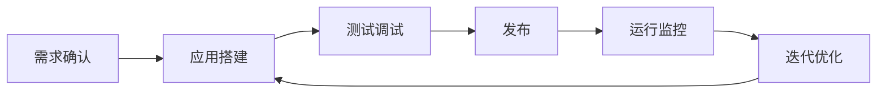

# 从开发到上线：ADP 应用的完整使用流程

## 本章目标

学完本章后，你应当能够：

- 描述从需求确认到上线的完整流程。
- 说明测试调试、发布、监控与迭代的要点。
- 解释上线后回滚与持续运营的作用。

## 核心概念

- **测试调试**：在发布前验证应用行为与效果。
- **发布**：把应用部署到目标环境供用户使用。
- **监控**：持续观察运行状态、指标与异常。
- **迭代**：根据反馈与数据持续优化。

## 原理与机制

完整流程是：需求确认 → 应用搭建 → 测试调试 → 发布 → 运行监控 → 迭代优化。上线不是终点，监控与迭代决定长期效果。

## 企业场景

一个知识助手上线后，团队通过日志与用户反馈发现部分问题回答质量不高。他们更新知识库、补充测试集、回归验证后发布新版本，形成持续优化闭环。

## 风险与常见误区

- **误区**：上线即结束。缺少监控与迭代会导致效果退化。
- **误区**：上线前不做回归验证。
- **风险**：没有回滚预案，严重问题时无法快速止损。

## 验收标准

能够画出从需求到上线的闭环流程，并说明监控与回滚的作用。

## 本章小结

从开发到上线是一个持续闭环。测试、监控与回滚预案是把智能体可靠交付给业务的关键保障。

## 自测题

1. 完整使用流程包含哪些阶段？  
   **答**：需求确认、应用搭建、测试调试、发布、运行监控、迭代优化。
2. 为什么要做回归验证？  
   **答**：确保改动没有让原本正常的能力退化。
3. 回滚预案的作用是什么？  
   **答**：出现严重问题时快速恢复到稳定版本。

## 来源

- 腾讯云 ADP 产品文档：https://cloud.tencent.com/document/product/1759  
  核验日期：2026-11-10
