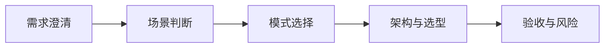

# 方案设计方法

## 本章目标

学完本章后，你应当能够：

- 按结构化的方法澄清需求。
- 判断场景适配并完成技术选型与架构设计。
- 制定可量化验收标准与风险应对。

## 核心概念

- **需求澄清**：明确业务目标、用户角色、现状流程与核心痛点。
- **场景适配判断**：判断问题是否适合智能体方案，以及适合哪种模式。
- **技术选型**：综合业务目标、现状、能力与成本选择方案。
- **验收标准**：可量化、可复现的效果指标与通过阈值。

## 原理与机制

方案设计遵循“先理解、再判断、最后设计”的顺序。先澄清需求，再判断是否适合以及适合哪种模式，接着确定架构与选型，最后制定验收与风险应对。

## 企业场景

某客户希望“降低人工客服成本”。方案设计不能直接开工，而要先澄清是售前咨询还是售后工单、用户是谁、数据在哪、如何衡量成功，再决定用知识助手还是工作流。

## 风险与常见误区

- **误区**：跳过需求澄清直接写提示词。
- **误区**：验收标准只写“效果好”。
- **风险**：识别风险但不制定应对措施。

## 验收标准

能够按结构输出一份包含需求、场景判断、架构、选型、验收与风险的方案骨架。

## 本章小结

方案设计是把模糊需求转化为可交付方案的过程，核心是澄清、判断、设计与验收的闭环。

## 自测题

1. 方案设计的第一步是什么？  
   **答**：澄清业务目标、用户角色、现状流程与核心痛点。
2. 验收标准为什么需要可量化？  
   **答**：便于客观判断是否达标，避免主观争议。
3. 技术选型应优先考虑什么？  
   **答**：业务目标、现状、能力与长期运维成本的综合平衡。

## 来源

- 腾讯云 ADP FDE 认证详情：https://cloud.tencent.com/edu/training/cert/detail?type=CFD  
  核验日期：2026-11-10
