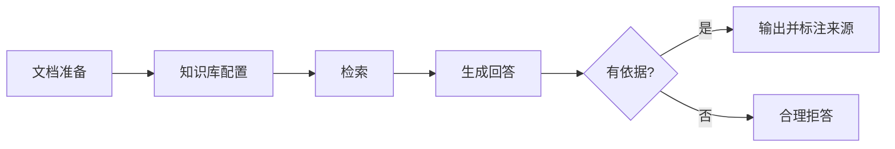

# 标准模式实战：知识助手

## 本章目标

学完本章后，你应当能够：

- 说明知识助手的标准搭建流程。
- 完成文档准备、知识库配置与检索问答。
- 制定知识助手的效果验收方法。

## 核心概念

- **知识助手**：以文档检索问答为主的智能体应用。
- **检索问答**：先检索相关资料，再基于资料生成回答。

## 原理与机制

知识助手的关键是让回答有据可依：准备并清洗文档 → 配置知识库与索引 → 检索相关内容 → 生成回答并标注来源。无依据时应合理拒答。

## 企业场景

一家软件公司把产品手册、FAQ 与工单历史整理后导入知识库，搭建技术支持助手。验收时重点检查回答准确率、来源可溯性与无依据时是否拒答。

## 风险与常见误区

- **误区**：文档越多越好，不重视质量。
- **误区**：知识助手必须回答所有问题。无依据时应拒答。
- **风险**：不校验来源，导致回答无法追溯。

## 验收标准

能够在给定文档集上搭建知识助手，并给出准确率、可溯源与拒答合理性三项验收指标。

## 本章小结

知识助手以“文档—检索—生成”为主线，文档质量与来源可溯性是效果的关键。

## 自测题

1. 知识助手的核心是什么？  
   **答**：基于文档检索生成有依据的回答。
2. 无依据时应该怎么做？  
   **答**：合理拒答，而不是编造。
3. 验收知识助手关注哪些指标？  
   **答**：准确率、来源可溯性与拒答合理性。

## 来源

- 腾讯云 ADP 产品文档：https://cloud.tencent.com/document/product/1759  
  核验日期：2026-11-10
