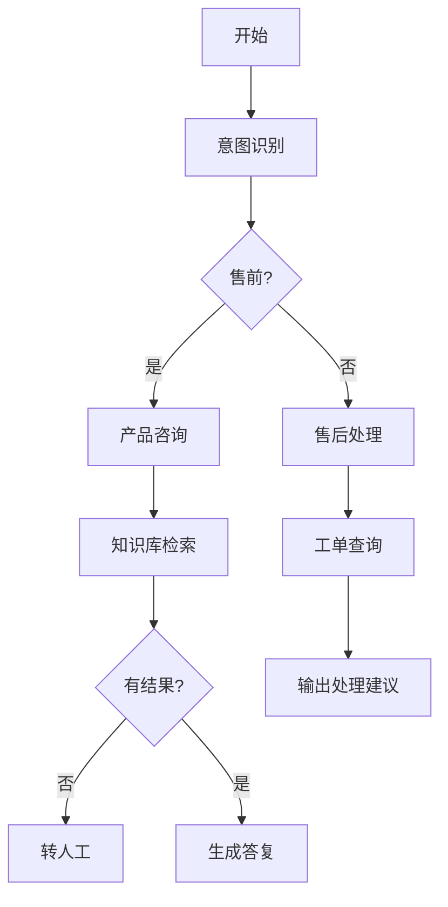

# 单工作流模式实战：客服助手

## 本章目标

学完本章后，你应当能够：

- 把客服诉求拆解为工作流节点。
- 设计条件分支、异常路径与人工兜底。
- 验证客服工作流的完整性与可观测性。

## 核心概念

- **工作流节点**：工作流中的最小执行单元。
- **条件分支**：根据输入或结果路由到不同路径。
- **人工兜底**：在模型无法可靠处理时转交人工。

## 原理与机制

客服工作流通常从意图识别开始，根据意图路由到不同分支，调用知识库或工具，并在检索无结果、调用失败或超出范围时进入异常路径或转人工。

## 企业场景

客服工作流需要处理“查物流”“退换货”“投诉”等多种诉求。通过分支路由与人工兜底，既保证常见问题自动处理，又保证敏感与异常场景有人接管。

## 风险与常见误区

- **误区**：只设计正常路径，忽略异常。
- **误区**：所有问题都自动回复，缺少人工兜底。
- **风险**：调用失败时静默忽略，用户得不到反馈。

## 验收标准

能够输出客服工作流图，覆盖正常、分支、异常与转人工路径。

## 本章小结

客服助手用工作流把诉求处理流程化，分支与兜底是可靠性的核心。

## 自测题

1. 客服工作流通常包含哪些节点？  
   **答**：开始/结束、意图识别、条件分支、知识库/工具调用、转人工等。
2. 人工兜底的作用是什么？  
   **答**：在模型无法可靠处理时转交人工，保证体验。
3. 调用失败时应如何处理？  
   **答**：重试、提示或转人工，而不是静默忽略。

## 来源

- [腾讯云 ADP 产品文档](https://cloud.tencent.com/document/product/1759)  
  核验日期：2026-11-10
