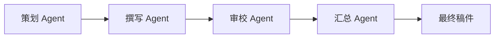

# Multi-Agent 模式实战：内容创作助手

## 本章目标

学完本章后，你应当能够：

- 按角色拆分内容创作任务。
- 定义协作协议与结果汇总方式。
- 设计质量检查与终止条件。

## 核心概念

- **角色拆分**：把任务按职责分配给不同 Agent。
- **协作协议**：Agent 之间传递信息与交接任务的约定。
- **结果汇总**：把多个 Agent 的输出整合为最终结果。

## 原理与机制

内容创作可拆分为策划、撰写、审校、汇总等角色，按流水线依次传递。每个 Agent 有清晰输入、输出与质量门槛，避免职责重叠。

## 企业场景

营销团队用 Multi-Agent 生成产品文案：策划确定角度，撰写产出初稿，审校检查事实与语气，汇总输出定稿。质量检查在每个环节生效。

## 风险与常见误区

- **误区**：所有 Agent 做相同工作，失去拆分意义。
- **误区**：只关注单个 Agent 质量，忽略交接信息丢失。
- **风险**：没有明确的终止条件导致协作失控。

## 验收标准

能够给出角色分工、协作协议、汇总方式与质量检查的完整设计。

## 本章小结

Multi-Agent 通过职责拆分与协作协议完成复杂任务，角色边界与质量检查是成功关键。

## 自测题

1. 内容创作助手如何拆分角色？  
   **答**：策划、撰写、审校、汇总，各司其职依次传递。
2. 协作协议的作用是什么？  
   **答**：约定信息传递与任务交接方式。
3. 为什么需要质量检查？  
   **答**：保证每个环节输出达到门槛，避免错误传递。

## 来源

- 腾讯云 ADP 产品文档：https://cloud.tencent.com/document/product/1759  
  核验日期：2026-11-10
