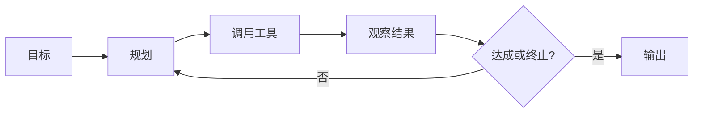

# Claw 模式实战

## 本章目标

学完本章后，你应当能够：

- 识别 Claw 模式的适用场景。
- 说明配置流程与执行过程。
- 制定风险控制措施。

## 核心概念

- **Claw 模式**：由模型自主规划并循环调用工具完成任务。
- **终止条件**：触发停止执行的规则，如最大步数、超时或目标达成。

## 原理与机制

Claw 模式让模型在“规划—调用工具—观察结果”的循环中自主推进，直到目标达成或触发终止条件。适合目标明确、步骤可验证、需要多次工具调用的任务。

## 企业场景

“根据给定资料自动整理一份项目周报”目标明确、结果可验证，适合 Claw 模式：模型自主读取资料、提取要点、按模板输出。

## 风险与常见误区

- **误区**：所有任务都用 Claw。结果不可验证时收益有限。
- **风险**：缺少最大步数与超时限制导致失控。
- **风险**：授予过大工具权限带来越权风险。

## 验收标准

能够说明 Claw 的适用条件，并列出最小权限、步数限制、人工审批与日志审计等控制措施。

## 本章小结

Claw 模式用自主循环完成目标明确的任务，终止条件与权限控制是可靠性的前提。

## 自测题

1. 什么任务适合 Claw 模式？  
   **答**：目标明确、步骤可验证、需要多次工具调用的任务。
2. Claw 需要哪些风险控制？  
   **答**：最小权限、步数/超时限制、人工审批、日志审计。
3. 为什么需要终止条件？  
   **答**：避免无限循环带来成本与失控。

## 来源

- 腾讯云 ADP 产品文档：https://cloud.tencent.com/document/product/1759  
  核验日期：2026-11-10
