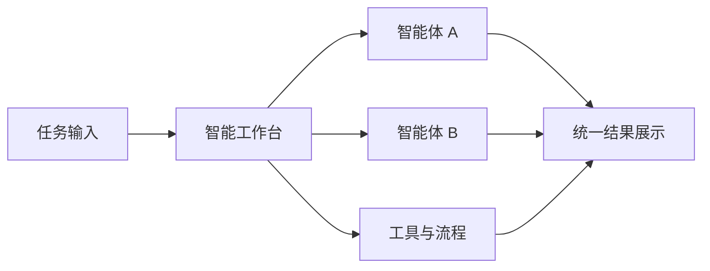

# 智能工作台实战

## 本章目标

学完本章后，你应当能够：

- 说明智能工作台的典型能力与价值。
- 描述其使用流程。
- 判断哪些团队协作场景适合智能工作台。

## 核心概念

- **智能工作台**：集中管理与编排多个智能体能力、统一展示任务状态与结果的工作界面。

## 原理与机制

智能工作台把多个智能体、工具与流程集中到一个入口，统一管理任务、展示结果并沉淀可复用流程，提升团队协作与交付效率。

## 企业场景

一个交付团队用智能工作台承接客户需求：不同智能体分别负责需求澄清、方案起草、风险检查，工作台统一汇总任务状态与产出，团队在同一个界面协同。

## 风险与常见误区

- **误区**：工作台可以替代人的判断与责任。
- **风险**：任务状态不统一导致信息分散。

## 验收标准

能够说明智能工作台的能力、价值与一个典型使用流程。

## 本章小结

智能工作台通过集中管理与统一展示提升协作效率，是辅助工具而非责任替代。

## 自测题

1. 智能工作台的典型价值是什么？  
   **答**：集中管理多个智能体能力、统一展示状态与结果、沉淀流程。
2. 工作台是否替代人的责任？  
   **答**：不替代，是协作工具。

## 来源

- 腾讯云 ADP 产品文档：https://cloud.tencent.com/document/product/1759  
  核验日期：2026-11-10
