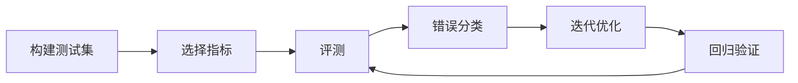

# 智能体调试与评测基础

## 本章目标

学完本章后，你应当能够：

- 说明测试集与评价指标的作用。
- 区分常见评价指标。
- 建立错误分类与回归验证机制。

## 核心概念

- **测试集**：用于量化评估模型或应用表现的代表性样本集合。
- **评价指标**：准确率、召回率、相关性、响应时间等量化标准。
- **回归验证**：确保改动没有让原本正常的能力退化。

## 原理与机制

评测先建立有代表性的测试集，再选择合适的指标量化表现。每次迭代都通过回归验证确认没有退化，并持续更新测试集覆盖新发现的错误类型。

## 企业场景

一个知识助手上线前，团队准备了 100 道覆盖常见问题的测试集，记录准确率与召回率；每次调整提示词或知识库后都重新跑一遍，确认没有回归。

## 风险与常见误区

- **误区**：只用单一指标衡量效果。
- **误区**：测试集一次性构建后不再维护。
- **风险**：迭代后不做回归验证。

## 验收标准

能够为给定场景选择合适指标，并说明回归验证的价值。

## 本章小结

评测是智能体持续优化的基础。测试集、指标、错误分类与回归验证构成完整闭环。

## 自测题

1. 测试集的作用是什么？  
   **答**：用量化的代表性样本评估表现。
2. 准确率与召回率的区别是什么？  
   **答**：准确率看预测正确的占比，召回率看被找到的相关结果占比。
3. 为什么需要回归验证？  
   **答**：确认改动没有让原本正常的能力退化。

## 来源

- [腾讯云 ADP FDE 认证详情](https://cloud.tencent.com/edu/training/cert/detail?type=CFD)  
  核验日期：2026-11-10
