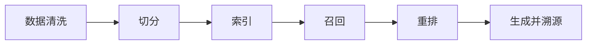

# 知识库质量与 RAG 调优

## 本章目标

学完本章后，你应当能够：

- 说明知识库数据清洗与切分的要点。
- 解释召回、重排与上下文构造。
- 建立答案溯源与质量迭代机制。

## 核心概念

- **数据清洗**：去除噪声、重复与错误内容。
- **切分**：把文档拆分为适合检索的片段。
- **召回与重排**：先检索候选片段，再按相关性排序。
- **答案溯源**：为回答标注来源文档。

## 原理与机制

RAG 效果取决于数据质量与检索质量。数据要清洗、去重、更新；切分粒度要与问题类型匹配；召回后通过重排提升相关性；最终生成时引用来源。

<RagWorkflowDemo />

## 企业场景

制度文档存在多个历史版本。团队先清理过期版本，再按条款切分，保证检索到的都是现行有效内容，回答时标注具体条款。

## 风险与常见误区

- **误区**：切分越细越好。过细会丢失上下文。
- **误区**：只调模型不查数据。数据问题往往被模型放大。
- **风险**：不标注来源，无法追溯。

## 验收标准

能够说明数据清洗、切分、召回、重排与溯源的完整链路。

## 本章小结

知识库质量决定 RAG 上限。数据清洗、合理切分、召回重排与答案溯源缺一不可。

## 自测题

1. 数据清洗的目标是什么？  
   **答**：去噪、去重、纠错，提升检索与回答质量。
2. 切分过细会带来什么问题？  
   **答**：片段丢失上下文，回答不完整。
3. 答案溯源的作用是什么？  
   **答**：让回答可追溯、可验证。

## 来源

- 腾讯云 ADP 产品文档：https://cloud.tencent.com/document/product/1759  
  核验日期：2026-11-10
