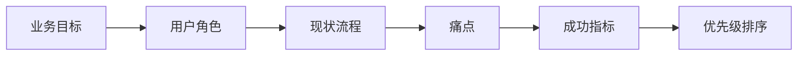

# 客户场景理解与需求分析

> 本章为**补充学习**内容，不属于腾讯云官方课程原章节。

## 本章目标

学完本章后，你应当能够：

- 系统收集业务目标、用户角色、现状流程与核心痛点。
- 识别约束条件与成功指标。
- 对多个需求进行优先级排序。

## 核心概念

- **业务目标**：客户希望通过项目达成的结果。
- **现状流程**：当前业务的运行方式。
- **成功指标**：可量化地衡量项目是否成功。

## 原理与机制

需求分析从“谁、为什么、现在怎样、卡在哪、怎样算成功”五个问题出发，把模糊诉求转化为可验证的目标与约束，再进行优先级排序。

## 企业场景

客户提出“做一个智能客服”。通过追问发现真正目标是“降低夜间人工值守成本”，成功指标是“夜间常见问题自动解决率达到 80%”。这比泛泛的“智能客服”更可交付。

## 风险与常见误区

- **误区**：只记录需求，不澄清目标。
- **误区**：按提出者职位排序优先级。
- **风险**：成功指标不可量化导致验收争议。

## 验收标准

能够把一段客户描述转化为包含目标、角色、流程、痛点、约束与指标的需求清单。

## 本章小结

需求分析是把诉求转化为可交付目标的过程，关键在于澄清目标与量化成功。

## 自测题

1. 需求澄清通常收集哪些信息？  
   **答**：业务目标、用户角色、现状流程、痛点、约束、成功指标。
2. 优先级排序应综合哪些因素？  
   **答**：业务价值、紧急程度、实现成本与风险。
3. 为什么成功指标要可量化？  
   **答**：便于客观验收，避免争议。

## 来源

- [FDE 认证指南与生态伙伴](https://adp.tencent.com/zh/blog/adp-fde-certification-guide)  
  核验日期：2026-11-10
