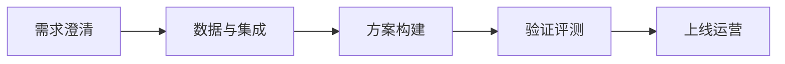

# 行业解决方案与案例落地

> 本章为**补充学习**内容，不属于腾讯云官方课程原章节。

## 本章目标

学完本章后，你应当能够：

- 说明零售、金融、制造、教育、医疗等行业的共性需求与差异。
- 理解行业方案落地的共性步骤。
- 将案例方法迁移到新行业时正确适配。

## 核心概念

- **共性需求**：跨行业通用的能力要求，如知识问答、系统集成与风险治理。
- **行业差异**：数据形态、流程、合规要求与用户诉求的差异。

## 原理与机制

行业方案既有共性也有差异。共性步骤是“需求澄清 → 数据与集成准备 → 方案构建 → 验证评测 → 上线运营”；差异体现在数据、流程与合规上，需要针对性地重新设计。

## 企业场景

零售关注导购与推荐，金融关注合规与审计，制造关注设备运维，教育关注个性化辅导，医疗关注隐私与安全。把零售导购的成功方法迁移到金融时，需要重新处理数据脱敏与合规。

## 风险与常见误区

- **误区**：把案例原样照搬到新行业。
- **误区**：忽视行业合规差异。
- **风险**：只讲方案不讲验证与运营。

## 验收标准

能够举例说明两个行业的差异，并给出案例迁移的正确做法。

## 本章小结

行业方案的价值在于把共性方法结合行业约束落地，差异必须被识别和尊重。

## 自测题

1. 跨行业的共性需求有哪些？  
   **答**：知识问答、系统集成、效果评测、风险治理、持续运营。
2. 行业差异的根源是什么？  
   **答**：数据形态、业务流程、合规要求与用户诉求。
3. 案例迁移的正确做法是什么？  
   **答**：抽象可复用方法，并针对新行业约束重新设计与验证。

## 来源

- [FDE 认证指南与生态伙伴](https://adp.tencent.com/zh/blog/adp-fde-certification-guide)  
  核验日期：2026-11-10
