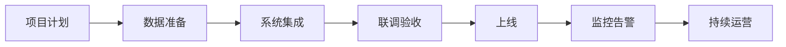

# 项目交付与运维

> 本章为**补充学习**内容，不属于腾讯云官方课程原章节。

## 本章目标

学完本章后，你应当能够：

- 说明项目计划、数据准备与系统集成。
- 掌握联调验收、上线回滚与监控告警。
- 建立持续运营与迭代机制。

## 核心概念

- **联调验收**：多方系统联合调试并确认达到验收标准。
- **回滚**：出现严重问题时恢复到稳定版本。
- **监控告警**：持续观察运行指标并在异常时告警。

## 原理与机制

交付项目按“计划 → 数据准备 → 集成 → 联调验收 → 上线 → 监控 → 运营迭代”推进。回滚预案与监控告警是上线后的安全保障。

## 企业场景

上线前团队完成数据脱敏、接口联调与测试集验收；上线后监控回答质量与接口成功率，设置告警；出现严重问题时按预案回滚。

## 风险与常见误区

- **误区**：上线即结束，不安排监控与运营。
- **风险**：没有回滚预案，问题扩大。
- **风险**：数据准备不充分导致集成失败。

## 验收标准

能够输出一份包含计划、数据、集成、验收、上线、监控与回滚的交付方案。

## 本章小结

交付与运维是智能体落地的最后闭环，监控、告警与回滚是可靠性的底线。

## 自测题

1. 上线后应建立哪些机制？  
   **答**：监控、告警、回滚预案与持续运营。
2. 回滚预案的作用是什么？  
   **答**：严重问题时快速恢复稳定版本。

## 来源

- [FDE 认证指南与生态伙伴](https://adp.tencent.com/zh/blog/adp-fde-certification-guide)  
  核验日期：2026-11-10
