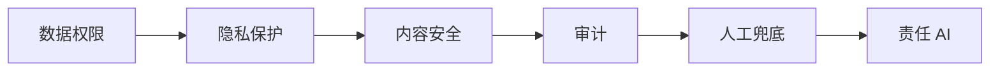

# 安全合规与责任 AI

> 本章为**补充学习**内容，不属于腾讯云官方课程原章节。

## 本章目标

学完本章后，你应当能够：

- 说明数据权限、隐私保护与越权访问的防控。
- 解释内容安全、幻觉风险与审计。
- 理解责任 AI 的核心原则。

## 核心概念

- **最小权限**：只授予完成任务所必需的最小权限。
- **内容安全**：拦截违法违规与不当内容。
- **责任 AI**：公平、透明、可解释、可问责与安全的 AI 使用原则。

## 原理与机制

安全合规需要覆盖数据、内容与流程三个层面：数据上做脱敏与权限隔离，内容上做安全审核，流程上做审计与人工兜底。责任 AI 把这些要求沉淀为组织机制。

## 企业场景

一个面向客户的助手需要查询用户订单。系统按用户身份隔离数据、对敏感字段脱敏、记录访问日志，并对高风险结论做人工复核。

## 风险与常见误区

- **误区**：安全是上线后再补的事项。
- **风险**：越权访问导致数据泄露。
- **风险**：完全信任模型输出，缺少兜底。

## 验收标准

能够说明数据、内容、流程三个层面的安全措施，并列举责任 AI 原则。

## 本章小结

安全合规是智能体交付的硬约束。最小权限、内容审核、审计与人工兜底共同构成责任 AI。

## 自测题

1. 最小权限原则指什么？  
   **答**：只授予完成任务所必需的最小权限。
2. 防止越权访问的做法有哪些？  
   **答**：权限隔离、工具授权校验、访问审计、角色数据范围控制。
3. 责任 AI 的核心原则有哪些？  
   **答**：公平、透明、可解释、可问责与安全。

## 来源

- [FDE 认证指南与生态伙伴](https://adp.tencent.com/zh/blog/adp-fde-certification-guide)  
  核验日期：2026-11-10
