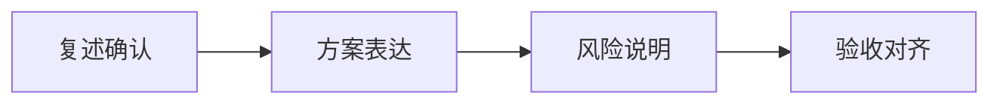

# FDE 项目沟通与方案表达

> 本章为**补充学习**内容，不属于腾讯云官方课程原章节。

## 本章目标

学完本章后，你应当能够：

- 复述客户需求并确认理解一致。
- 表达方案取舍与风险。
- 明确验收口径与沟通方式。

## 核心概念

- **需求复述**：用自己的话回述需求，确认双方理解一致。
- **方案取舍**：说明各方案的利弊与选择依据。
- **验收口径**：明确如何判断项目成功。

## 原理与机制

有效的项目沟通遵循“复述确认 → 方案表达 → 风险说明 → 验收对齐”的顺序，把技术方案翻译为客户能理解的价值与风险。

## 企业场景

向客户汇报时，先复述“您的目标是降低夜间人工成本”，再说明推荐方案及取舍，接着指出数据质量等风险，最后确认“夜间常见问题自动解决率达到 80%”作为验收口径。

## 风险与常见误区

- **误区**：用大量技术术语淹没客户。
- **风险**：需求理解不一致导致返工。
- **风险**：验收口径模糊导致争议。

## 验收标准

能够把技术方案表达为客户可理解的价值、取舍、风险与验收口径。

## 本章小结

FDE 沟通能力是把方案价值讲清楚、把风险讲明白、把验收对齐好的能力。

## 自测题

1. 为什么需要需求复述？  
   **答**：确认双方理解一致，避免返工。
2. 方案取舍要说明什么？  
   **答**：各方案的利弊与选择依据。
3. 验收口径为什么重要？  
   **答**：明确成功标准，避免争议。

## 来源

- FDE 认证指南与生态伙伴：https://adp.tencent.com/zh/blog/adp-fde-certification-guide  
  核验日期：2026-11-10
